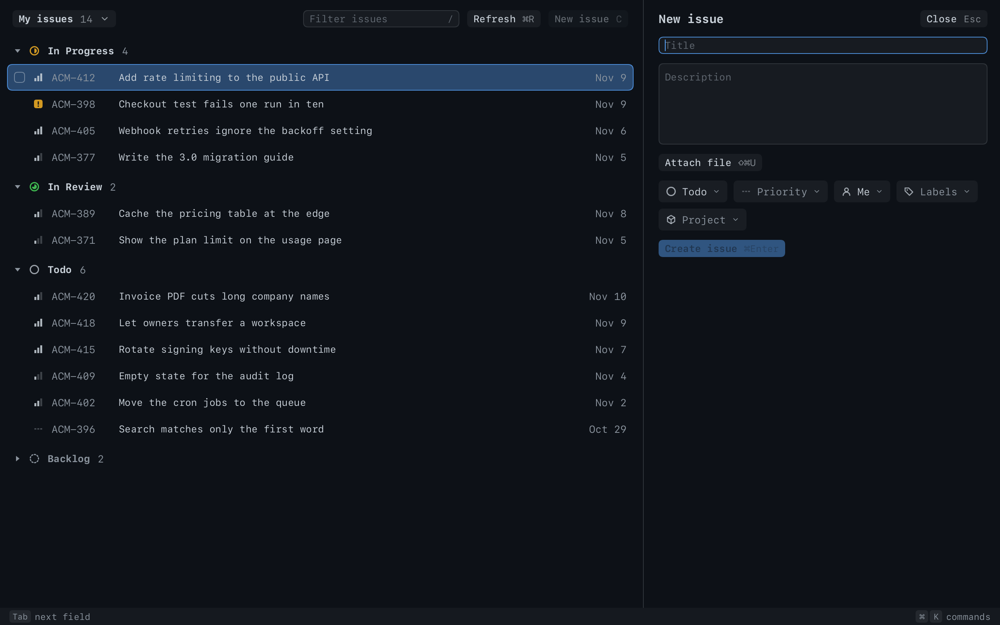
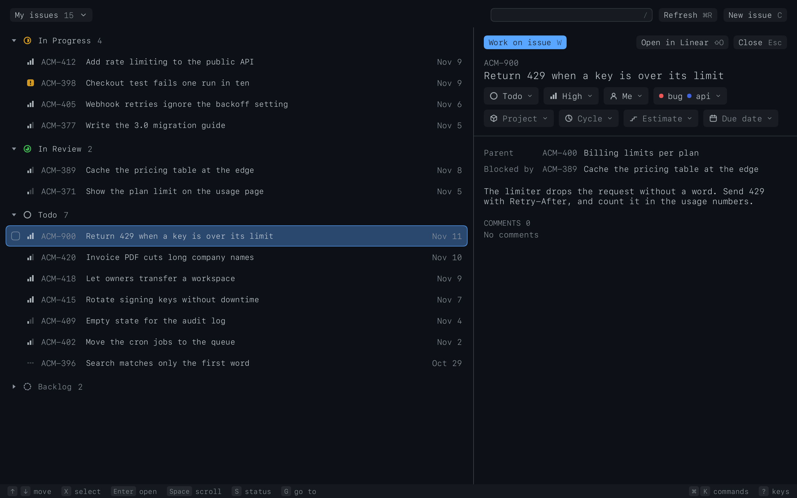
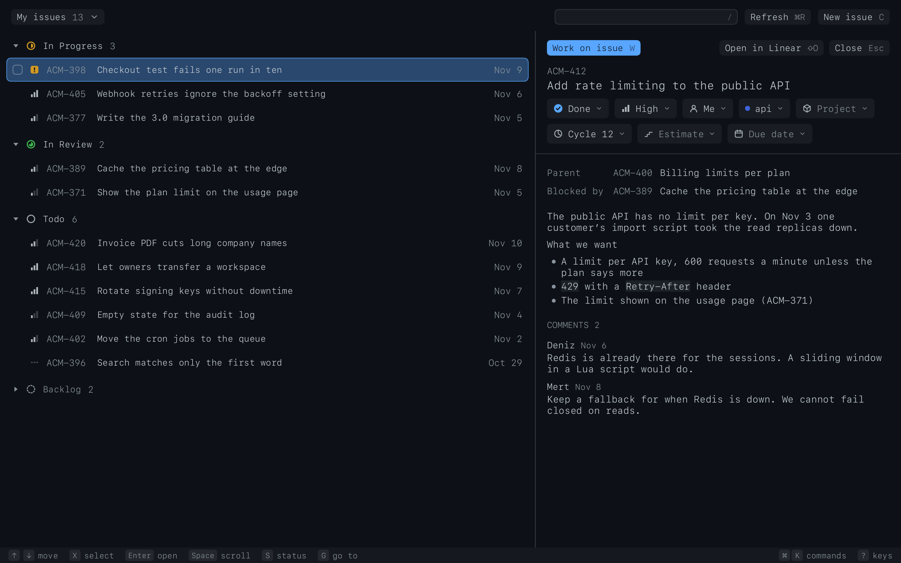
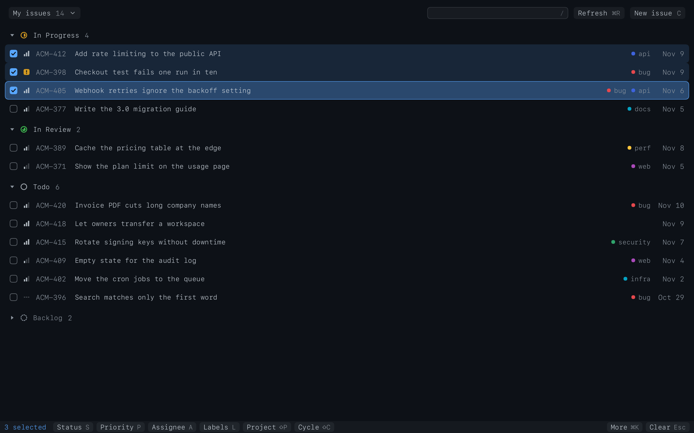
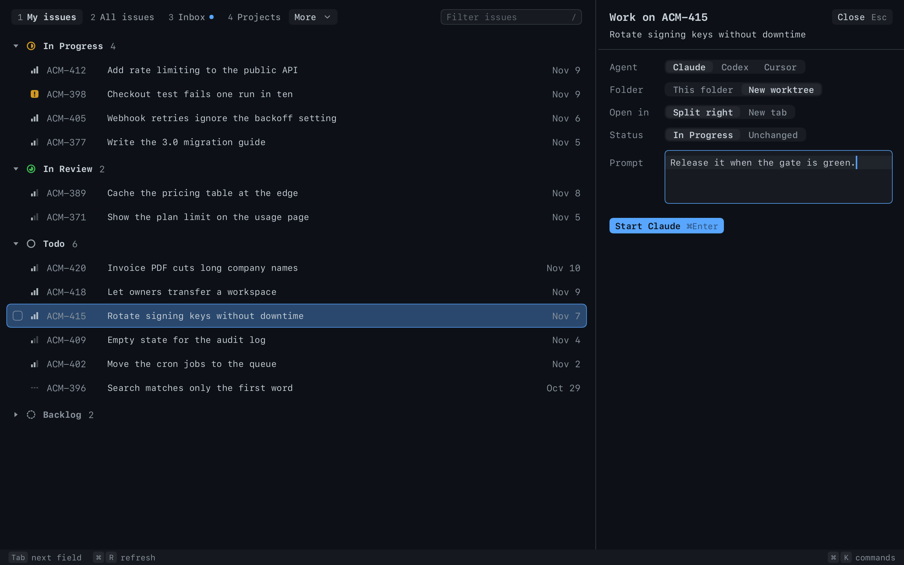
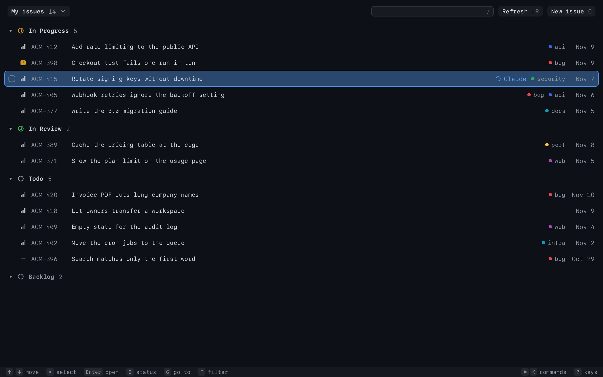
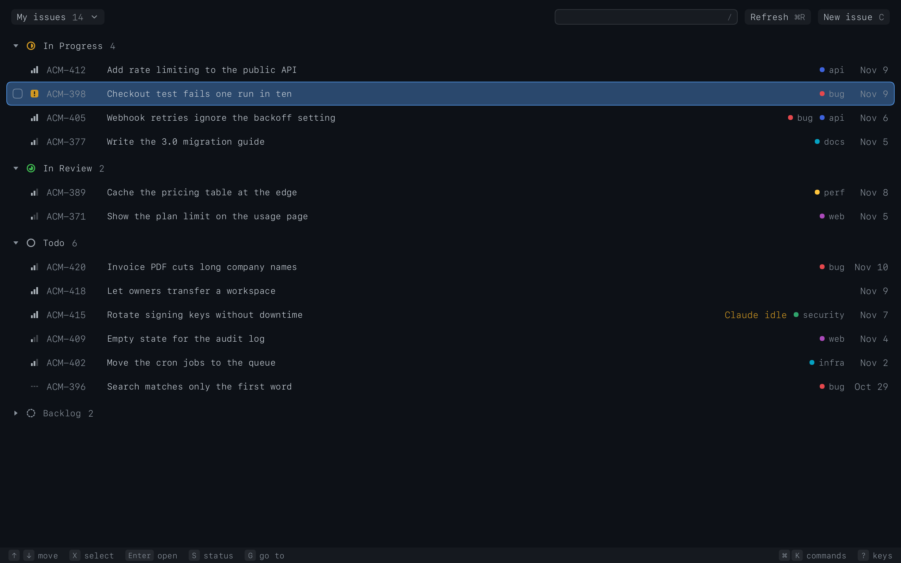

# linearpen

Your Linear issues in a terminal pane, and an agent started on the one you open: a list grouped
by state, an issue beside it with its description and comments, and Claude, Codex or Cursor
working on it in the pane next to it. You can write a new issue in it too, and change
the status, priority, assignee, labels, project and title of the issues you have; those are the two
things it writes to Linear, and never the description.


## Use

linearpen is a [pencere](https://github.com/bateri/pencere) program, one native file with the
interface inside it. Run it in a terminal that hosts pencere views
([bateri](https://github.com/bateri/bateri)) and the pane becomes the interface, the way `vim`
takes the screen and gives it back. Run it anywhere else and it prints your issues as text.

```sh
linearpen            # the interface
linearpen --text     # your issues as text, whatever the terminal is
```

There is no release yet: it is built from its source, with Rust and `curl`.

```sh
make install                     # builds it and puts it in ~/.local/bin
make install INSTALL_DIR=~/bin   # or in another folder
make uninstall                   # takes it away again
```

Or run it where it is built: `cargo build --release`, then `target/release/linearpen`.

### The key

linearpen asks Linear with a personal API key that has Read permission, Create issues too if you
want to make new issues in it, and Write too if you want to change the issues you have. Make one in Linear under Settings, Account, Security & Access. A pane that has no key asks for one (the field hides what you type),
tries it with a question to Linear and keeps it in the file `key` of `~/.config/linearpen` (or of
`$XDG_CONFIG_HOME/linearpen`), made readable by you alone. `LINEAR_API_KEY` in the environment is
used first, and kept nowhere. A key file that other users can read is still read, and `linearpen --text` warns about it.

### Your issues


The head of the page has the list button, the filter, Refresh and New issue, each in its own place
whatever the page is doing. The list is **My issues** (what is assigned to you) or **All issues** (the
open issues of the workspace, each saying whose it is), grouped by state with the backlog folded, and
asked of Linear again every five minutes; the list button says which it is and how many it has, and
opens the card of lists (`g`, or `1` and `2` for the two). `/` filters the list by title, identifier or
label, and the field says how many it lets through (`4 of 14`) inside itself. Enter or `o` opens an
issue beside the list (from the filter too), with its description, its comments, its cycle, its
project and who has it, and the issues round it: its parent, its sub-issues and what it is tied to
(blocks, blocked by, related, duplicate of), each a line that a press opens; Space scrolls it, and
`Open in Linear` (`⇧O`, from the list too) puts it in your browser. In a pane too narrow for both, the issue takes the pane: there the arrows scroll it, and
`j` and `k` go to the issue after and the one before. A pane with too little room for Refresh and New
issue leaves their buttons out; `⌘R` and `c` do what they say all the same.

### A new issue



`c` opens a form beside the list with what Linear's own asks: a title, a description, and the
values of the issue: the team (where the workspace has more than one), its status, its priority,
who it is assigned to (you, to begin with), its labels and its project. Each value is a button that
says what it is now and opens a menu of the others, and Tab goes through them all. `⌘Enter`, or
`Create issue`, makes the issue.



The list then shows the issue where it is, under the cursor and open beside the list, with its group
unfolded and the filter off. `Esc` puts the form away and keeps what you wrote until the issue is
made. If Linear does not make it the form says why, with what you wrote still in it. The issue is
sent once, with an identity the program gave the draft, so pressing Create again after an answer that
was lost asks Linear for that issue before it sends anything else and never makes two. A key without
Create issues permission is told so in the form.

### Change an issue


The status, priority, assignee, labels and project of the issue that is open are buttons, the same
ones the form of a new issue has, and so are its cycle, its estimate and its due date: each says what
it is now (or its name, dim, where it has none) and opens a menu of the others, the status with every
state of the team (Done and Canceled too). The cycle menu has the cycle that runs and the next ones,
and the estimate menu the scale the team uses (t-shirt sizes are sent as the numbers Linear takes
them as): a team with no cycles, or that does not estimate, has neither button. The due date menu has
Today, Tomorrow, In 3 days, In a week and In 2 weeks, by your own day. The title is changed in place: `r`, or a press
on it, makes it a field with the words selected; `Enter` saves it, and so does a press anywhere else
or `Tab` (what you typed is not lost), and `Esc` leaves the old one. A
change is sent when you choose it, with no question; the control is busy until Linear has answered,
and if Linear says no the words are under the controls and the value is as it was. A change that
moves the issue puts it in its new group with the cursor on it, and one that takes it out of the list
(done, canceled, given to someone else while you look at your own) leaves the issue open beside the
list, with its new value, until you move the cursor again.



From the list the keys do the same: `s` the status, `p` the priority, `a` the assignee, `i` assigns
it to you, `l` the labels, `Shift P` the project, `Shift C` the cycle, `Shift E` the estimate,
`Shift D` the due date and `r` the title (which opens the issue, to write in
its title) of the issue under the cursor, or of **all the issues you selected**, up to fifty at once,
in one request to Linear (`r` is for one). A label that every one of them has is taken off and one
that not every one has is put on all of them. Issues of more than one team can only change their
priority and due date, and the menu says so.

`x` selects an issue, Shift with the arrows selects more, `⌘A` selects what is shown. With issues
selected the line under the page is the bar of the selection: how many are selected, the values to
change in them (Status, Assignee, and in a wider pane Priority, Labels, Project and Cycle), `More` (`⌘K`, with
every change) and `Clear` (`Esc`). A press on a value opens its menu for all of them, and `Esc` takes
the selection off and gives the line of keys back.


A right press on a line opens the menu of that issue (or, on a line that is selected, of all that are
selected): the values above, `Assign to me`, and for one issue `Rename`, the copies and `Open in
Linear`. A value picked there opens the menu of that value for those issues. The copies are keys too:
`⌘⇧I` puts the identifier of the issue on the pasteboard (`ACM-412`), `⌘⇧.` its branch name (where
Linear has one) and `⌘⇧,` its link, and the page says so for a moment.



The change is sent once. Where no answer comes it is not sent again by the program: it tells you, and
asks Linear what the issue holds now. The description and the team are never written.

### Work on an issue

Work on is one issue's and is in its detail, at the start of the first line, where Linear has it: the
list has no button for it, and a selection starts no agent (it changes values). Open the issue (Enter),
then `w` or `Work on issue` opens its form.



In the form, choose the agent (the ones of Claude, Codex and Cursor that are in your `PATH`), whether
it works in this folder or makes a new `git` worktree for the work, whether its pane splits to the
right or opens a new tab, and whether the issue moves to the status of work in progress if it has not
begun (`Status`: the name of its team's first such state, or `Unchanged`; the row is not there when
the issue has begun). There is no field for words to the agent: it opens in its own pane, and you
write to it there. `⌘Enter` starts it, and the issue says which agent is on it until the pane ends.
When the agent stops writing, the row says `Claude idle` where the ring was. The form opens with what
you chose last time (agent, folder, where the pane goes and `Status`), which is kept in
`~/.local/state/linearpen/prefs.json`.





How it starts one:

- It asks bateri for the pane (`bateri split` or `bateri tab`), so nothing is started outside a
  bateri pane, and the form says why. Where linearpen runs on a server, in a pane bateri opened over
  `ssh`, the agent is started on that server: its pane, the file of the issues and the agent itself
  are there, so the agent has to be installed there.
- Then, if `Status` says so, an issue in Triage, Backlog or Todo goes to the first state of work in
  progress of its team. Only forward and only the status: an issue that has begun, is done or is
  canceled is left as it is, and nothing is written if the pane was not made. If Linear says no, the
  agent is started all the same and the list says the issue did not move.
- The issue, with its description and comments, is written to a file that only you can read, in
  `~/.local/state/linearpen/work` (`$XDG_STATE_HOME`), and the agent is told where it is. What the
  agent is started with is a sentence that names the file, never the text of the issue.
- That file says, before anything else, that other people wrote the issue, so what is in it is
  read as a description of the work and not as an order.
- A new worktree is the agent's to make, not linearpen's: a project has its own rules for where
  one goes and what its branch is called, and the agent reads them. It is asked to follow them and,
  where there are none, to use the branch Linear suggests, which the file gives for the issue
  (only where it is a name `git` would take). linearpen itself makes no folder and no branch.
- While an agent is on, bateri is asked for its panes every three seconds (`bateri ls --json`, of which
  only the id of a pane and when it last wrote are read). A pane that has written nothing for ten
  seconds is an agent that has stopped, because it is done or because it waits for you: linearpen
  cannot tell which, so the row says `Claude idle` and no more, and the ring comes back when the pane
  writes. Where bateri does not say, the row stays as it was.
- The files of the issues are for the agent to read, and are put away after 14 days: when linearpen
  begins and after each start, the folders under `work` that it made and that are older than that
  are removed, unless it is the file of a pane that this run of linearpen started and still
  watches. A folder with anything else in it is left, and nothing outside `work` is touched.
- No option that lets an agent skip its questions is ever given.

### The keyboard, and the mouse

Everything the mouse does, the keys do too. The line at the foot says what the keys do where you are,
`?` lists them all and `⌘K` finds a command by its name; a right press on an issue opens its menu. A click does not move the keyboard to what it
pressed: the arrows and `Enter` stay the list's, and `Tab` takes the keyboard to a button, which `Enter`
or `Space` then presses.

| Key                   | What it does                                                         |
| --------------------- | -------------------------------------------------------------------- |
| `↑` `↓` / `j` `k`     | move                                                                 |
| `←` `→`               | close and open a group                                               |
| `Enter`, `o`          | open the issue beside the list                                       |
| `⇧O`                  | open it in Linear                                                    |
| `Space`, `⇧ Space`    | scroll the open issue down, up                                       |
| `x`, `Shift ↑↓`, `⌘A` | select the issue, select more, select all                            |
| `s` `p` `a` `l` `⇧P`  | change the status, priority, assignee, labels, project               |
| `⇧C` `⇧E` `⇧D`        | change the cycle, the estimate, the due date                         |
| `i`                   | assign it to you                                                     |
| `r`                   | change the title                                                     |
| `⌘⇧I` `⌘⇧.` `⌘⇧,`     | copy the identifier, the branch name, the link                       |
| `w`                   | work on the issue that is open                                       |
| `c`                   | write a new issue                                                    |
| `⌘Enter`              | start the agent, or create the issue, in the form that is open       |
| `g`                   | go to a list (`1` `2`: My issues, All issues)                        |
| `/`                   | filter                                                               |
| `⌘R`                  | ask Linear again                                                     |
| `⌘K`, `?`             | find a command, the card of keys                                     |
| `Esc`                 | close what is on top: the form, the issue, the selection, the filter |

## It writes two things

linearpen tells Linear a new issue and a change to the issues you have, and nothing else. It has two
mutations, `IssueCreate` (sent when you press Create in the form) and `IssueBatchUpdate` (sent when you
choose a status, a priority, an assignee, a label, a project, a cycle, an estimate, a due date or a title, for one issue or for those you
selected; and sent once more, only for the status, when you start an agent with `Status` set to move
the issues that have not begun), and the list of mutations it may send is one place in the program that a test checks every
query against, refusing any other before it is sent. What a change can be is a type of its own with
those fields in it: the description and the team of an issue cannot be written by it, and a
test looks for them in what is sent. A comment, an archive or a deletion changed from here would be a
decision of its own. It does not send anything twice by itself: a new issue has an identity the draft
was given, and an issue whose answer was lost is asked for by it; a change whose answer was lost is
not sent again, and the issue is asked for.

## It talks to Linear with `curl`

There is no HTTP or TLS library in linearpen: Linear is asked by the `curl` of your machine, with
the key on its standard input, so it is not in its arguments (where `ps` shows them) or in its
environment. The key is not written to a log, to an error message, to the page or to the file an
agent reads. What Linear sends back is treated as what other people wrote: a branch name does not
reach `git` before `git check-ref-format` has passed it, and no text of Linear goes through a shell.

## How it works

- `src/program/` is linearpen's program, in Rust, on the `pencere` crate. The rule of its directories
  is one sentence: **`api/` knows the page; `linear/`, `model/`, `state/`, `work/` and `text/` do
  not.** `linear/` asks Linear through `curl`, `model/` groups, sorts and filters, `state/` keeps the
  key, `work/` hands an issue to an agent, `text/` prints the issues where a terminal shows no views;
  `api/` is what the page asks and listens to, and `docs/calls.md` is that contract.
- `src/view/` is the interface, a page of pencere's kit: boxes and lines of text that the terminal
  lays out and draws in its own font and theme, every colour a role of the theme. `commands.lua` is
  the one table of commands that the keys, the palette, the card of keys and the buttons are made
  from.
- `build.rs` carries the page and its pictures in the program: `target/release/linearpen` is the
  one file.

## Work on it

You need Rust and git. linearpen is built and tested with [pencere](https://github.com/bateri/pencere)
at the commit its `Cargo.lock` names, which `make` fetches into `.cache/pencere` and builds there:
`make fake-host` the stand-in terminal the tests play linearpen in, and `make dev` the `pencere`
command that runs the page in a pane.

```sh
make fake-host      # the stand-in terminal, built once (and again when Cargo.lock moves pencere)
make check          # formatting, lints, the program's tests, and the page's tests
make shots          # the pictures of docs/, drawn in the fonts of this machine
make dev            # in a pane of a terminal that hosts pencere: run it from its files,
                    # and again when one under src/ changes
```

What the tests are:

- `tests/e2e.rs` runs the built program in a pane under the stand-in terminal with a **stand-in
  `curl`, `bateri` and agents** first on the `PATH` (`test/stand-in/bin/`), and a home of its own:
  what the page is told for each call and topic, what is asked of Linear, what is handed to an agent.
  Nothing in them reaches Linear, a bateri that is open, or a key of yours.
- `src/program/page_tests.rs` runs the page as a terminal runs it, on pencere's host with no screen,
  with the program's own handlers in the same process, over made-up issues.

The page's tests open the kit's interpreter, so they are `cargo test`'s ignored ones, and `make
check` runs them.

## License

linearpen is free software: you can redistribute it and/or modify it under the terms of the
[GNU General Public License](LICENSE) as published by the Free Software Foundation, either version 3
of the License, or (at your option) any later version. It is distributed in the hope that it will be
useful, but WITHOUT ANY WARRANTY; see the license for details.
