# linearpen

Your Linear issues in a terminal pane, and an agent started on the one you open: a list grouped
by state, an issue beside it with its description and comments, and Claude, Codex or Cursor
working on it in the pane next to it. You can write a new issue in it too, change
the status, priority, assignee, labels, project and title of the issues you have, edit their
description, leave a comment and edit your own, and add files to them (pictures, PDFs, anything up to
100 MiB); those are the only things it writes to Linear.

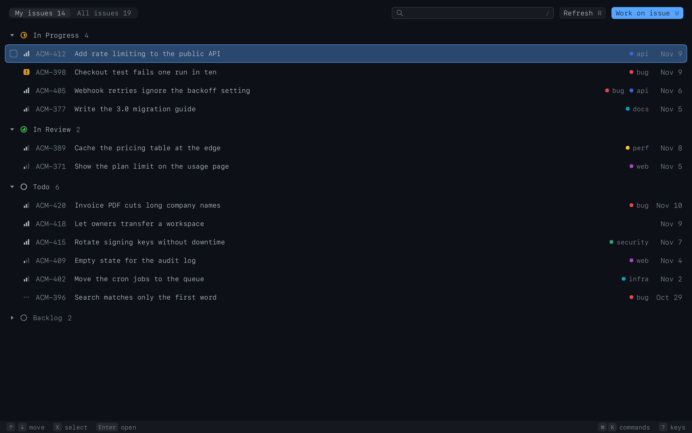

## Install

linearpen is one file for each system, with nothing to install beside it, for macOS on Apple
silicon and Linux on arm64 and x86_64. It talks to Linear with `curl`, which it finds on the `PATH`:

```sh
curl -fsSL https://raw.githubusercontent.com/bateri/linearpen/main/install.sh | sh
```

To see the interface you need a terminal that hosts pencere views
([bateri](https://github.com/bateri/bateri)) or one that speaks Kitty's graphics protocol (Ghostty,
kitty), where linearpen draws it itself, on a keyboard where Ctrl is what Cmd is on a Mac. Any other
terminal is given the issues as text, as `linearpen --text` prints them.

The installer takes the newest [release](https://github.com/bateri/linearpen/releases) (or
`LINEARPEN_VERSION=0.1.0`), checks it against the release's `SHA256SUMS`, and puts it in
`~/.local/bin` (`LINEARPEN_INSTALL=<dir>` puts it elsewhere). A file a browser downloads is
quarantined by macOS; one curl downloads is not.

A release has two files for each system, and the one to download by hand is
`linearpen-<version>-<target>`. The `linearpen-no-terminal-<version>-<target>` one is smaller and is
what bateri and kablo install; it does not draw in a terminal by itself.

The Linux files are linked statically, so that one runs on any distribution. To build it from its
source instead, with Rust and `curl`:

```sh
make install                     # builds it and puts it in ~/.local/bin
make install INSTALL_DIR=~/bin   # or in another folder
make uninstall                   # takes it away again
```

Or run it where it is built: `cargo build --release`, then `target/release/linearpen`.

## Use

linearpen is a [pencere](https://github.com/bateri/pencere) program, one native file with the
interface inside it. Run it in a terminal that hosts pencere views
([bateri](https://github.com/bateri/bateri)), or in one that speaks Kitty's graphics protocol, and the
pane becomes the interface, the way `vim` takes the screen and gives it back. Run it anywhere else and
it prints your issues as text.

```sh
linearpen            # the interface
linearpen --text     # your issues as text, whatever the terminal is
```

### Command line

The same program does what you ask of it without the interface, to read an issue in a script or
to change many at once. A name is written as Linear shows it (capital letters do not matter); where
a name is none of the team's, or is more than one, nothing is sent and the names there are come
back. `list` and `--text` print the open issues; `--status Done` lists the done ones.

```sh
linearpen list --team ACM --status "In Progress" --assignee me
linearpen show ACM-412
linearpen create --team ACM --title "Fix the login" --priority high --label bug
linearpen update ACM-412 ACM-413 --status Done --unlabel wip
git diff | linearpen comment ACM-412 --body -
linearpen comment ACM-412 --body "It looks like this" --attach shot.png
linearpen comment ACM-412 --edit last --body "It looks like this, on Safari only"
linearpen update ACM-412 --description - < description.md   # the whole description, in place of the one there
linearpen show ACM-412 --files files    # the files of the issue, saved as files in files
linearpen teams ACM        # the names a team's issues can be given
```

`list`, `show` and `teams` only read (`show --files DIR` also writes files, in DIR, and nothing in
Linear); `create`, `update` and `comment` write what the things below say. Each takes `--json`, whose fields are in [docs/cli.md](docs/cli.md), and
`linearpen help COMMAND` tells its options. A command ends with 0 when it is done, 1 where Linear could
not do it or has nothing by a name, 2 where the command is not understood or there is no key, and 3
where a write was sent and it is not known whether Linear made it: look in Linear before running it
again.

### The key

linearpen asks Linear with a personal API key that has Read permission, Create issues too if you
want to make new issues in it, and Write too if you want to change the issues you have. Make one in Linear under Settings, Account, Security & Access. A pane that has no key asks for one (the field hides what you type),
tries it with a question to Linear and keeps it in the file `key` of `~/.config/linearpen` (or of
`$XDG_CONFIG_HOME/linearpen`), made readable by you alone. `LINEAR_API_KEY` in the environment is
used first, and kept nowhere. A key file that other users can read is still read, and `linearpen --text` warns about it.

### Your issues


The head of the page has the list button, the filter, Refresh and New issue, each in its own place
whatever the page is doing (in a pane too narrow for the list and an issue beside it, the head goes
with the list). The list is **My issues** (what is assigned to you) or any other list
you go to: **All issues** (the issues of the workspace, each saying whose it is), what you
starred in Linear, the issues or the running cycle of a team you are in (in the order of your own
list of teams), a saved view, a project. Each holds its open issues and the 100 done and canceled
ones that changed last, grouped by state with the backlog, Done and Canceled folded, and is asked of
Linear again every five minutes; the Status filter finds older ones. The list
button says which it is and how many open issues it has, and opens the card of lists (`g`): My issues is `1`, All
issues `2`, your first seven favorites `3` to `9`; the card is the palette, so typing finds a list by
its name, and each line says what it is (`View`, `Project`, `Team`, `Cycle 24, ends Nov 15`). Only
the list you look at is asked for (with My issues), so the others cost nothing until you go to
them. Linear is asked for no more than 500 issues of a list, the open ones first. Where there are
more open ones, the button says `500+` and a line at the end of the list says so.

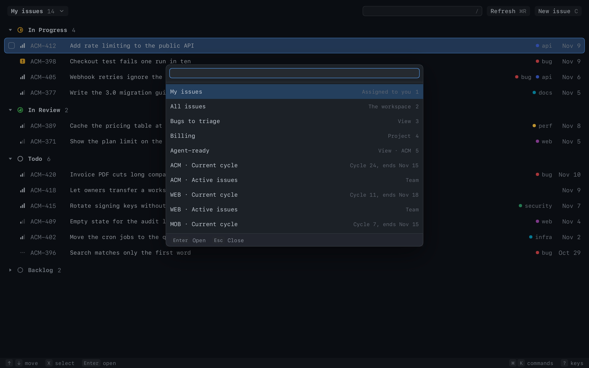

`f` opens a row of five filters under the head: Status, Priority, Assignee, Labels and Project. The
keyboard is on the first (`Tab` goes on, `Enter` opens its card, `Esc` gives the keyboard back to the
list). In a chip's card you check and uncheck values, typing to find one, and it stays open until `Esc`
or a click elsewhere, so a chip can hold several (any of them) and the chips together narrow the list
(all of them). Linear does the narrowing, whichever list you are in:
the filters go with the list's own filter, and are asked for again when they change. With the keyboard
on the list only what you set stays, a chip with its values and `Clear filters` (`⇧F`); with none set
there is no row. They are forgotten when the pen closes.

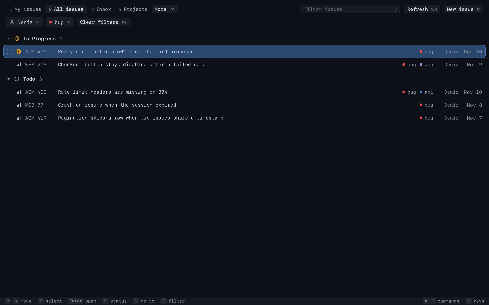

`/` filters the list by title, identifier or
label, and the field says how many it lets through (`4 of 14`) inside itself. While you type, `⌘Enter`
searches all of Linear for the words (the whole workspace, up to 500; the closed groups begin
folded): the result is a list of its own, **Search**, the words stay in the field, the filters
apply to it, and `Esc` goes back to the list you were in. Where nothing in the list matches, the page
says so and offers the same search.

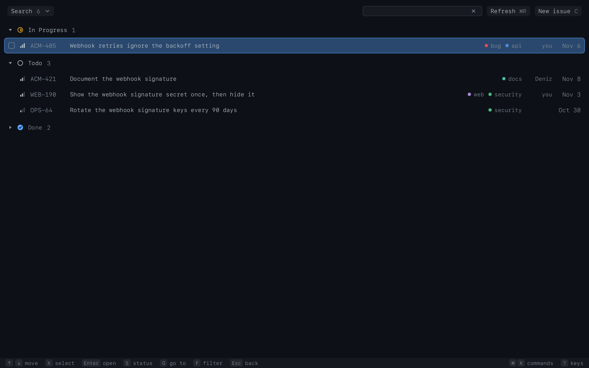

Enter or `o` opens an
issue beside the list (from the filter too), with its description, its comments, its cycle, its
project and who has it, and the issues round it: its parent, its sub-issues and what it is tied to
(blocks, blocked by, related, duplicate of), each a line that a press opens; Space scrolls it, and
`Open in Linear` (`⇧O`, from the list too) puts it in your browser. In a pane too narrow for both, the issue takes the whole pane, the list's name and filter with it: there the arrows scroll it, and
`j` and `k` go to the issue after and the one before. A pane with too little room for Refresh and New
issue leaves their buttons out; `⌘R` and `c` do what they say all the same.

### A new issue


`c` opens a form beside the list with what Linear's own asks: a title, a description, and the
values of the issue: the team (where the workspace has more than one), its status, its priority,
who it is assigned to (you, to begin with), its labels and its project. Each value is a button that
says what it is now and opens a menu of the others (the labels open a card where you check several),
and Tab goes through them all. `⌘Enter`, or
`Create issue`, makes the issue.


The list then shows the issue where it is, under the cursor and open beside the list, with its group
unfolded and the filter off. `Esc` puts the form away and keeps what you wrote until the issue is
made. If Linear does not make it the form says why, with what you wrote still in it. The issue is
sent once, with an identity the program gave the draft, so pressing Create again after an answer that
was lost asks Linear for that issue before it sends anything else and never makes two. A key without
Create issues permission is told so in the form.

### Change an issue

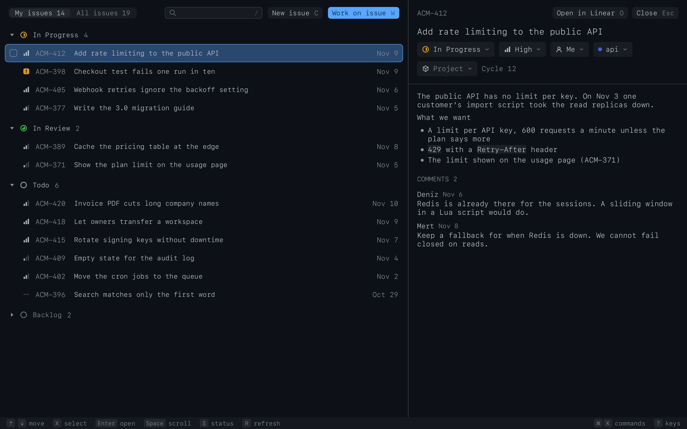

The status, priority, assignee, labels and project of the issue that is open are buttons, the same
ones the form of a new issue has, and so are its cycle, its estimate and its due date: each says what
it is now (or its name, dim, where it has none) and opens a menu of the others, the status with every
state of the team (Done and Canceled too). The cycle menu has the cycle that runs and the next ones,
and the estimate menu the scale the team uses (t-shirt sizes are sent as the numbers Linear takes
them as): a team with no cycles, or that does not estimate, has neither button. The due date menu has
Today, Tomorrow, In 3 days, In a week and In 2 weeks, by your own day. The labels open a card rather
than a menu: type to find a label, check and uncheck as many as you like (each is sent as you check
it), and `Esc` or a click elsewhere puts the card away. The title is changed in place: `r`, or a press
on it, makes it a field with the words selected; `Enter` saves it, and so does a press anywhere else
or `Tab` (what you typed is not lost), and `Esc` leaves the old one. A
change is sent when you choose it, with no question; the control is busy until Linear has answered,
and if Linear says no the words are under the controls and the value is as it was. A change that
moves the issue puts it in its new group with the cursor on it, and one that takes it out of the list
(done, canceled, given to someone else while you look at your own) leaves the issue open beside the
list, with its new value, until you move the cursor again.


From the list the keys do the same: `s` the status, `p` the priority, `a` the assignee, `i` assigns
it to you, `l` the labels, `Shift P` the project, `Shift C` the cycle, `Shift E` the estimate,
`Shift D` the due date and `r` the title (which opens the issue, to write in
its title) of the issue under the cursor, or of **all the issues you selected**, up to fifty at once,
in one request to Linear (`r` is for one). A label that every one of them has is taken off and one
that not every one has is put on all of them. Issues of more than one team can only change their
priority and due date, and the menu says so.

`x` selects an issue, Shift with the arrows selects more, `⌘A` selects what is shown. With issues
selected the line under the page is the bar of the selection: how many are selected, the values to
change in them (Status, Assignee, and in a wider pane Priority, Labels, Project and Cycle), `More` (`⌘K`, with
every change) and `Clear` (`Esc`). A press on a value opens its menu for all of them, and `Esc` takes
the selection off and gives the line of keys back.

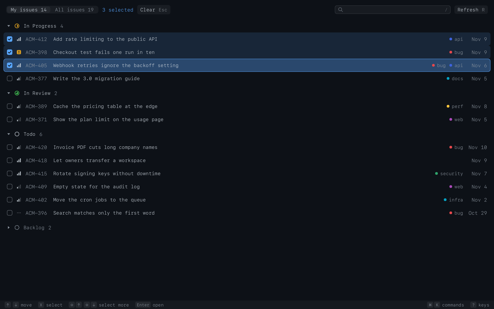

A right press on a line opens the menu of that issue (or, on a line that is selected, of all that are
selected): the values above, `Assign to me`, and for one issue `Rename`, the copies and `Open in
Linear`. A value picked there opens the menu of that value for those issues. The copies are keys too:
`⌘⇧I` puts the identifier of the issue on the pasteboard (`ACM-412`), `⌘⇧B` its branch name (where
Linear has one) and `⌘⇧L` its link, and the page says so for a moment. `Share` (`⌘⇧S`, and the button
beside the identifier of the issue open) puts its identifier, title and link on one line, to paste in a
chat or a message:
`ACM-412 Add rate limiting to the public API https://linear.app/acme/issue/ACM-412/add-rate-limiting-to-the-public-api`.
Where an issue is open, `r`, the copies and `⇧O` are that issue's, whatever is selected, as the buttons
of its panel are; the keys that change a value stay with the selection.


The change is sent once. Where no answer comes it is not sent again by the program: it tells you, and
asks Linear what the issue holds now. A change never writes the description (that is Edit description,
below) nor the team, which is never written.

A line can be dragged out of the page: into a terminal's pane it brings the issue as one line
(`ACM-412 Add rate limiting to the public API https://linear.app/...`), put at the cursor and not run
(read it before `Enter`, as any text you paste into a shell, for a title is anyone's); into another
application it is that line as text, and the link for those that take one. A line break, a tab or a
mark that is no letter in a title is a space in it; a title with a control of the direction of text
(an embedding, an override, an isolate) is not carried. The line that is dragged is the one that is
carried, not the selection. It needs a terminal that carries what a page offers, as bateri does.

### Comment on an issue

Under the comments of the issue that is open there is a field to write one (`⇧M` gives it the keyboard
and brings it into view). While the keyboard is in it the keys are the field's: `⌘Enter` or the Comment
button posts the words, `Esc` leaves the field with the words in it, `Tab` goes on to Comment. The words
stay for the issue, whichever issue is open, until they are posted; they are never sent by themselves,
and `⌘Enter` posts nothing while the keyboard is elsewhere (the button is the way then).
A comment is up to 10 000 characters. It is sent once, as it was written; if Linear does not post it,
the page says so under the field and the words stay, and where no answer came it says that the comment
may have been posted, and asks Linear for the issue instead of sending it again.

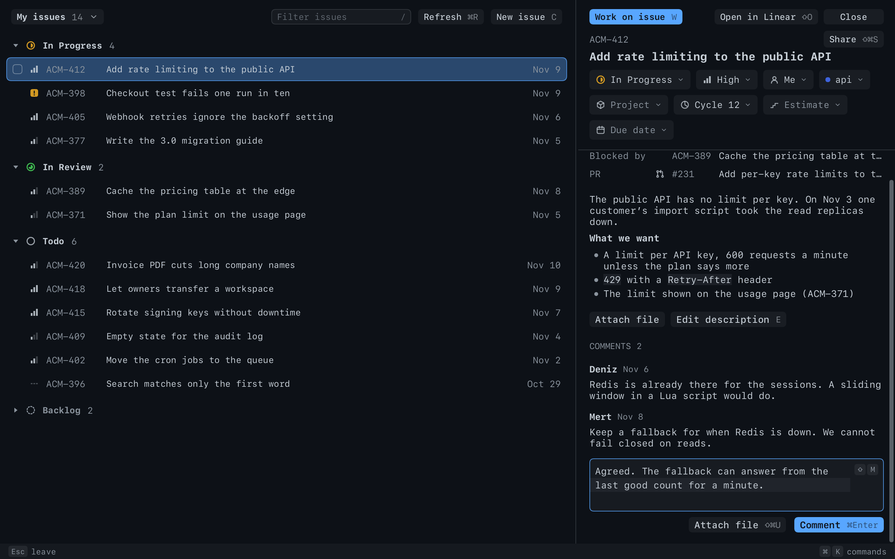

### Edit a description or a comment

`Edit description` (`e`), under the description of the issue that is open, makes it a field that holds
it whole, as Linear holds it now (the page shows at most 20 000 characters of a description, and never
edits what it shows). A comment you wrote has `Edit comment` at the end of its line; `⌘⇧M` edits the
last one you wrote. Linear lets only the one who wrote a comment edit it, so other comments have none.
`⌘Enter` or `Save` writes your words, `Esc` leaves the field with the words in it and a second `Esc`
(or `Cancel`) lets the edit go. The words stay for the issue while you look at others, and are never
sent by themselves. While a description is edited, `Attach file` puts files at the end of it, with Save.

Just before it writes, linearpen reads the words from Linear again. Where someone changed them while you
were editing, nothing is written and the page says so, with your words still in the field: `Save` again
puts yours in the place of theirs, `Cancel` shows theirs. A save whose answer was lost says so, and
saving again is safe: words Linear holds already are not sent again. A comment that is edited says
`edited` after its day.

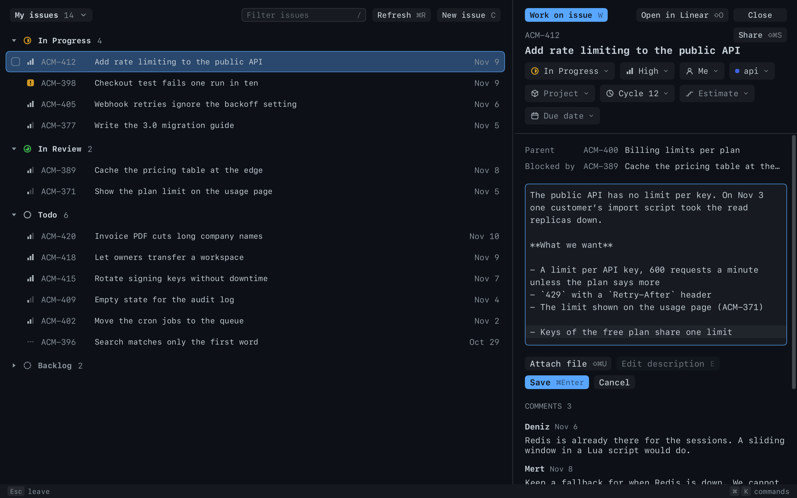

### Files

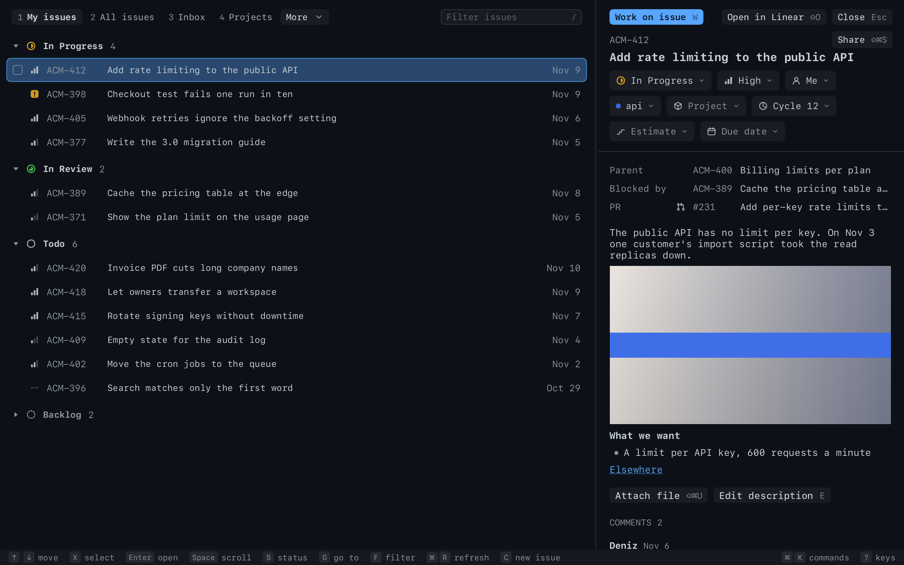

A picture in a description or a comment (``) is drawn where it
is written, as wide as the panel at most and never larger than it is. While it comes there is a pale
box with its name. A click, or `Enter` on it, opens it over the pane (`Esc` closes it and the keyboard
stays on the picture, and a pinch zooms it where the terminal's pencere can). A link to a file of
Linear that stands alone in its paragraph (`[name](https://uploads.linear.app/...)`) is a file too. A picture
of an address that is not Linear's is never fetched: it is a link in its words (the host where it has none),
and a click, or `Enter` on it, opens the address in your browser (only `http` and `https`; the tip says the
whole address).

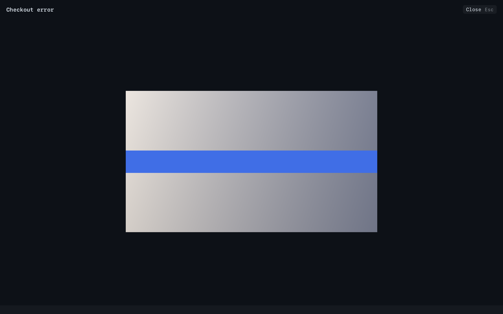

A PDF (up to 8 MiB) and every other file (a GIF, a WebP, a video, a log, a zip, a picture that is too
large to show) is a card: the icon of what it is, its name, what it is, and why it is not drawn where it
is a picture ("GIF is not shown here", "5120×2880 Too large to show here", "Could not be fetched"; a picture
written as one is always an `Image` with its reason). A card has one verb, `Open` for a PDF and `Save` for any
other, and the whole card is pressed for it. The rest is in its right-click menu and in the commands, for
the card that has the keyboard or the one you opened the menu on: `Save` of a PDF (`⌘S`), `Open the link`
(`⇧⌘E`, in your browser) and `Copy the file's link` (`⇧⌘K`); `Open` on a PDF is also `⇧⌘R`.

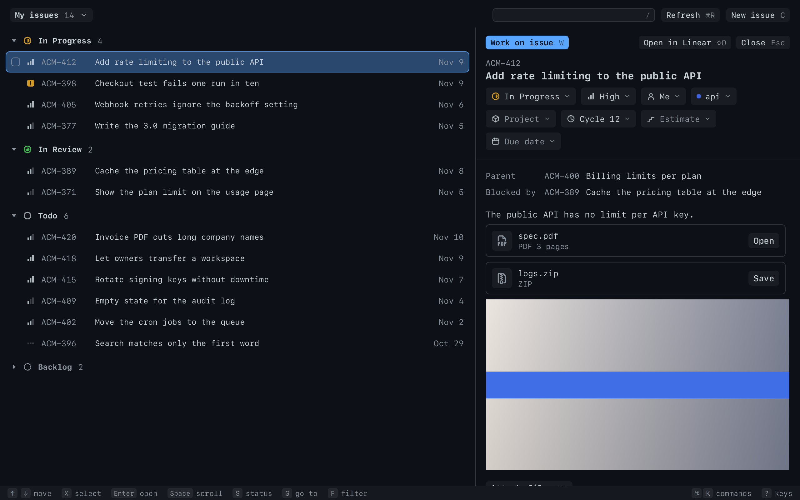

`Save` asks where, in the panel of the terminal, and linearpen writes the file there, up to 100 MiB, from
Linear (the key goes to `uploads.linear.app` and nothing else; a copy of its own, that only you can read,
is made on the way and taken away). The keys do the same: `Tab` to a card's button and `Enter`, or `⌘S` for the card whose button
has the keyboard (or for the only card the issue has, or the one you opened the menu on). Only
`uploads.linear.app` is fetched, with your key, by `curl`, and any other address is never asked for, with the
key or without it. Where the terminal speaks only Kitty's graphics protocol a picture is its name (not tried
in Kitty).

`Open` on a PDF's card opens it over the pane, a page at a time: `Previous` (`←`) and `Next` (`→`).
`Close` (`Esc`) is at the top, and `Find` (`⌘F`) and `Save` (`⌘S`) end the row of the pages. A key that has a
button is written on the button, and the line under the page says only what no button has (`⌘C` copy, `⌘A`
select all). Opening the search moves none of these buttons.

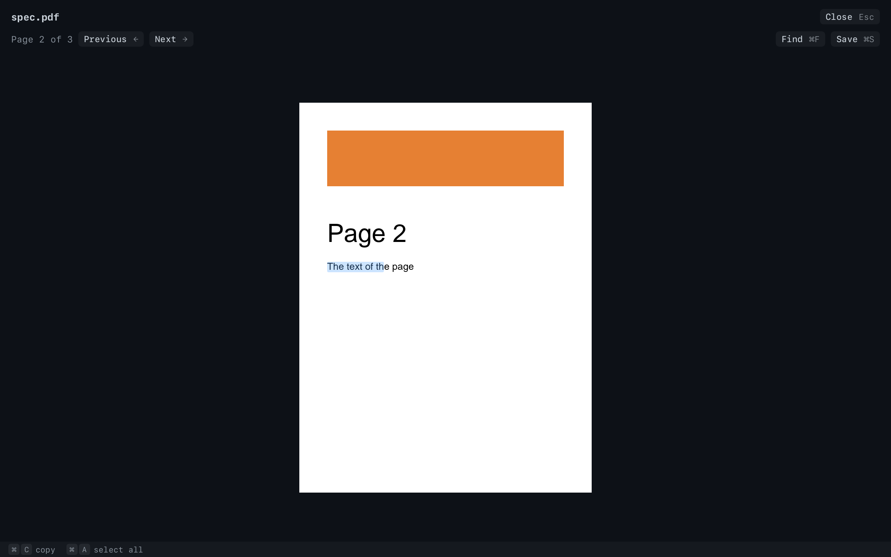

The words of a PDF can be selected with the pointer (a double click takes a word, a triple click the line,
a drag more) or with `Shift` and the arrows, copied with `⌘C`, and looked for: `Find` (`⌘F`) opens a field
under the pages, every match is marked on the page it is on, `Enter` and `⇧Enter` (or `⌘G` and `⇧⌘G`) go from
match to match (`Previous match`, `Next match`), and a match on another page turns the page to it. `Esc` is
written on the button it does: `Done` while the search is open (`Close` has no `Esc` then), else `Close`; it
never clears the selection (a press elsewhere does). A selection is of one page; what the search looks for is written as it is
(capitals do not count), not a pattern. Where a PDF has no words (it is pictures) there is no `Find`.

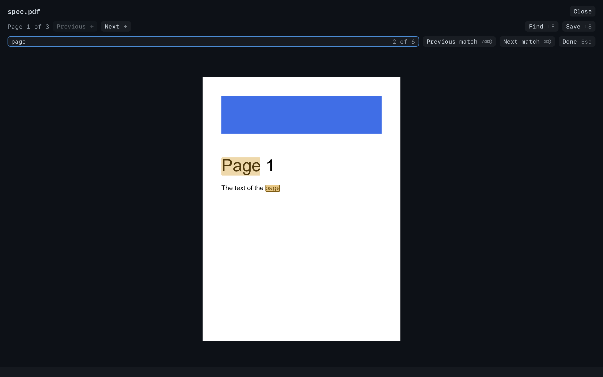

`Attach file` (`⌘⇧U`) puts a file, of any kind up to 100 MiB, in the comment you write, in the form of a new
issue or at the end of the description of the issue that is open, whichever has the keyboard; it opens
the Open panel, and where bateri hosts the view a file can also be pasted (`⌘V`) or dropped on the
comment, on the description or on the form. Up to ten go at a time. What is added waits under the field:
a picture as a small picture, any other file as a card with the icon of its kind, its name and its size, each
with `Remove`; the cards are all of one width (the name is shortened where it does not fit, and the tip says
it whole; a narrow pane gives each a row); nothing is sent until you press Comment, Create issue or `Add to description`.

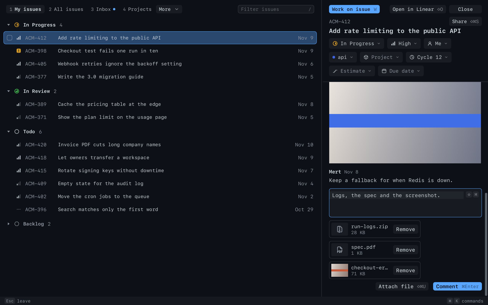

The files are put in Linear's storage first, one after the other, and then the text is written once,
with a line for each after your words (the comment may have no words, and the issue no description):
`` for a picture (PNG, JPEG, GIF or WebP, told by its first bytes, not by its name) and
`[name](address)` for any other file. If a file cannot be put in storage, nothing is written and what you added is
still there. A file the storage took stays there, with no issue to show it: linearpen cannot delete it. The
file is read from the terminal in pieces, into a copy of its own, and is not held in memory.

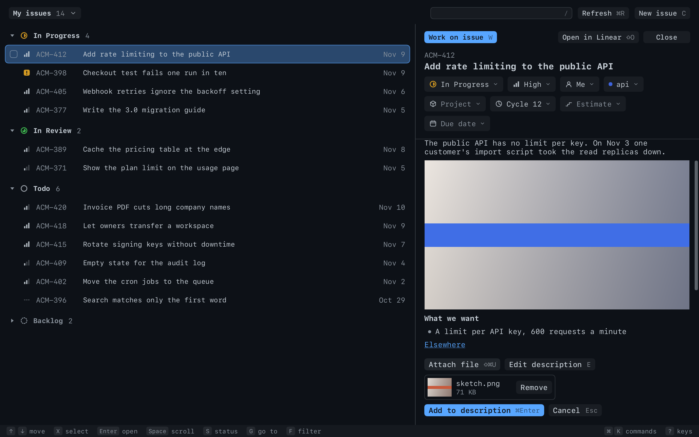

Linear has no way to add to the end of a description, so linearpen reads the whole description from
Linear just before it writes, puts the file lines after it and sends that, the description and
nothing else. It is never sent from what the page holds. Where the description cannot be read whole,
nothing is written. A description is Markdown that Linear stores in its own form, and a part of it
that is not plain text (a mention, say) may not come back as it was: this is not tried on a real
Linear workspace, so look at the issue after the first time.

On the command line the same: `show` prints each file where it stands as `[image N: name]` or
`[file N: name]` and lists them at the end; `--files DIR` saves the ones on Linear as files (up to
100 MiB each, 100 files and 1 GiB in all) and tells where; `--attach PATH` adds a file to a comment (`comment`), to the new issue
(`create`) or to the end of the description (`update KEY-N --attach PATH`, which only `--description` goes with),
as many times as there are files (ten at most). See [docs/cli.md](docs/cli.md). An agent started with Work on
uses the same commands, and the file of an issue that has files says how many and gives the command that
saves them where it can read them.

### Work on an issue

Work on is one issue's and is in its detail, at the start of the first line, where Linear has it: the
list has no button for it, and a selection starts no agent (it changes values). Open the issue (Enter),
then `w` or `Work on issue` opens its form.


In the form, choose the agent (the ones of Claude, Codex and Cursor that are in your `PATH`), whether
it works in this folder or makes a new `git` worktree for the work, whether its pane splits to the
right or opens a new tab, and whether the issue moves to the status of work in progress if it has not
begun (`Status`: the name of its team's first such state, or `Unchanged`; the row is not there when
the issue has begun). `Prompt` takes words of yours for the agent, such as "Release it when the gate
is green": they end what it is started with. Leave it empty and you write to the agent in its own
pane. `⌘Enter` starts it, and the issue says which agent is on it until the pane ends.
When the agent stops writing, the row says `Claude idle` where the ring was. The form opens with what
you chose last time (agent, folder, where the pane goes and `Status`), which is kept in
`~/.local/state/linearpen/prefs.json`.


How it starts one:

- It asks bateri for the pane (`bateri split` or `bateri tab`), so nothing is started outside a
  bateri pane, and the form says why. Where linearpen runs on a server, in a pane bateri opened over
  `ssh`, the agent is started on that server: its pane, the file of the issues and the agent itself
  are there, so the agent has to be installed there.
- Then, if `Status` says so, an issue in Triage, Backlog or Todo goes to the first state of work in
  progress of its team. Only forward and only the status: an issue that has begun, is done or is
  canceled is left as it is, and nothing is written if the pane was not made. If Linear says no, the
  agent is started all the same and the list says the issue did not move.
- The issue, with its description and comments, is written to a file that only you can read, in
  `~/.local/state/linearpen/work` (`$XDG_STATE_HOME`), and the agent is told where it is. What the
  agent is started with is a sentence that names the file, never the text of the issue, and then
  your words from `Prompt`, marked as yours.
- Claude's session is named for the issue, `ACM-412 - Add rate limiting`, which it shows in its
  prompt box, its `/resume` list and the terminal's title (on one line, cut at 100 characters). This
  needs Claude Code 2.1.76 or later; Codex and Cursor are given no name.
- That file says, before anything else, that other people wrote the issue, so what is in it is
  read as a description of the work and not as an order.
- A new worktree is the agent's to make, not linearpen's: a project has its own rules for where
  one goes and what its branch is called, and the agent reads them. It is asked to follow them and,
  where there are none, to use the branch Linear suggests, which the file gives for the issue
  (only where it is a name `git` would take). linearpen itself makes no folder and no branch, and
  does not ask `git` anything, so New worktree is there in a folder that is no repository too (one
  that holds several): the agent makes the worktree of the repository under it that the issue is
  about.
- While an agent is on, bateri is asked for its panes every three seconds (`bateri ls --json`, of which
  only the id of a pane and when it last wrote are read). A pane that has written nothing for ten
  seconds is an agent that has stopped, because it is done or because it waits for you: linearpen
  cannot tell which, so the row says `Claude idle` and no more, and the ring comes back when the pane
  writes. Where bateri does not say, the row stays as it was.
- The files of the issues are for the agent to read, and are put away after 14 days: when linearpen
  begins and after each start, the folders under `work` that it made and that are older than that
  are removed, unless it is the file of a pane that this run of linearpen started and still
  watches. A folder with anything else in it is left, and nothing outside `work` is touched.
- The agent is told what `linearpen` can do for it in Linear: move its issue to another status, comment
  on it (and put a file, such as a screenshot or a log, at the end of the comment), add files to
  the end of the issue's description and make another issue (`linearpen update`, `comment` and `create`;
  [docs/cli.md](docs/cli.md)). Nothing in the program stops it from any of these: it is your key, so
  what it writes is in Linear under your name, and what keeps it in bounds is the agent's own question
  before it runs a command. The id is the one thing of Linear's in the command line (in the sentence
  it is given), and only where it is a UUID.
- Where the issue has files (pictures and others) the file says so, how many and where, and gives the command
  that saves them (`linearpen show <id> --files <folder>`): nothing is downloaded when the agent starts.
- No option that lets an agent skip its questions is ever given.

### The keyboard, and the mouse

Everything the mouse does, the keys do too. The line at the foot says what the keys do where you are,
`?` lists them all and `⌘K` finds a command by its name; a right press on an issue opens its menu. A click does not move the keyboard to what it
pressed: the arrows and `Enter` stay the list's, and `Tab` takes the keyboard to a button, which `Enter`
or `Space` then presses.

| Key                   | What it does                                                         |
| --------------------- | -------------------------------------------------------------------- |
| `↑` `↓` / `j` `k`     | move                                                                 |
| `←` `→`               | close and open a group                                               |
| `Enter`, `o`          | open the issue beside the list                                       |
| `⇧O`                  | open it in Linear                                                    |
| `⌘⇧↑` `⌘⇧↓`            | open its parent, open a sub-issue or a related issue (a menu)        |
| `Space`, `⇧ Space`    | scroll the open issue down, up                                       |
| `x`, `Shift ↑↓`, `⌘A` | select the issue, select more, select all                            |
| `s` `p` `a` `l` `⇧P`  | change the status, priority, assignee, labels, project               |
| `⇧C` `⇧E` `⇧D`        | change the cycle, the estimate, the due date                         |
| `i`                   | assign it to you                                                     |
| `r`                   | change the title                                                     |
| `⌘⇧I` `⌘⇧B` `⌘⇧L`     | copy the identifier, the branch name, the link                       |
| `⌘⇧S`                 | share: copy the identifier, the title and the link on one line       |
| `w`                   | work on the issue that is open                                       |
| `c`                   | write a new issue                                                    |
| `⇧M`                  | write a comment on the issue open (`⌘Enter` posts it, `Esc` leaves)  |
| `⌘Enter`              | start the agent, or create the issue, in the form that is open       |
| `g`                   | go to a list (`1` `2`: My issues, All issues; `3`-`9`: favorites)    |
| `/`                   | filter by words (`⌘Enter`: search all of Linear)                     |
| `f`, `⇧F`             | filter by status, priority, assignee, labels or project; clear them  |
| `⌘S` `⇧⌘R`            | save the file of the card that has the keyboard, read a PDF          |
| `⇧⌘E` `⇧⌘K`           | open that card's link in your browser, copy it                       |
| `⌘R`                  | ask Linear again                                                     |
| `⌘K`, `?`             | find a command, the card of keys                                     |
| `Esc`                 | close what is on top: the form, the issue, the selection, the search |

## It writes four things

linearpen tells Linear a new issue, a change to the issues you have, a comment you wrote and the
files you add, and nothing else, from the interface and from the command line (`create`, `update`,
`comment`). It has four mutations, `IssueCreate` (sent when you press Create in the form),
`IssueBatchUpdate` (sent when you choose a status, a priority, an assignee, a label, a project, a
cycle, an estimate, a due date or a title, for one issue or for those you selected; sent once more,
only for the status, when you start an agent with `Status` set to move the issue that has not begun;
and sent with a description when you add files to one, which is all it can change a description
to), `CommentCreate` (sent when you press Comment, `⌘Enter`, under the comments of the issue open,
with the words you wrote and the lines of the files) and `FileUpload` (sent for each file, to
be given a place in Linear's storage). The list of mutations it may send is one place in the program
that a test checks every query against, refusing any other before it is sent. What a change can be is
a type of its own with those fields in it: it carries neither a description nor a team, and a test
looks for them in what is sent; the only description linearpen writes is the one it read whole from
Linear a moment before with the file lines after it. An archive, a deletion, an edit of a comment
or of the words of a description from here would be a decision of its own. It does not send anything
twice by itself: a new issue has an identity the draft was given, and an issue whose answer was lost
is asked for by it; a change or a comment whose answer was lost is not sent again, and the issue is
asked for (the comment says that it may have been posted, and your words stay in the field).

## It talks to Linear with `curl`

There is no HTTP or TLS library in linearpen: Linear is asked by the `curl` of your machine, with
the key on its standard input, so it is not in its arguments (where `ps` shows them) or in its
environment. The key goes to `api.linear.app` and, to fetch a file, to `uploads.linear.app` (exactly
that host, over https) and to no other; where the storage that takes a file is asked, with the
address Linear signed for it, there is no key at all. The file is read from a file of its own
that only you can read, which is deleted afterwards, and the signed address is in no log, error or
page. The key is not written to a log, to an error message, to the page or to the file an
agent reads. What Linear sends back is treated as what other people wrote: a branch name does not
reach `git` before `git check-ref-format` has passed it, and no text of Linear goes through a shell.

## How it works

- `src/program/` is linearpen's program, in Rust, on the `pencere` crate. The rule of its directories
  is one sentence: **`api/` knows the page; `linear/`, `model/`, `state/`, `work/` and `text/` do
  not.** `linear/` asks Linear through `curl`, `model/` groups, sorts and filters, `state/` keeps the
  key, `work/` hands an issue to an agent, `text/` prints the issues where a terminal shows no views;
  `api/` is what the page asks and listens to, and `docs/calls.md` is that contract.
- `src/view/` is the interface, a page of pencere's kit: boxes and lines of text that the terminal
  lays out and draws in its own font and theme, every colour a role of the theme. `commands.lua` is
  the one table of commands that the keys, the palette, the card of keys and the buttons are made
  from.
- `build.rs` carries the page and its pictures in the program: `target/release/linearpen` is the
  one file.

## Work on it

You need Rust and git. linearpen is built and tested with [pencere](https://github.com/bateri/pencere)
at the commit its `Cargo.lock` names, which `make` fetches into `~/.cache/pencere-build/<commit>`
(`make pencere-dir` says where; `PENCERE_HOME` moves it) and builds there: `make fake-host` the
stand-in terminal the tests play linearpen in, and `make dev` the `pencere` command that runs the
page in a pane. Every pen and every worktree built on the same commit shares that one checkout and
its build.

```sh
make fake-host      # the stand-in terminal, built once (and again when Cargo.lock moves pencere)
make check          # formatting, lints, the program's tests, the page's tests and the installer's
make shots          # the pictures of docs/, drawn in the fonts of this machine
make dev            # in a pane of a terminal that hosts pencere: run it from its files,
                    # and again when one under src/ changes
```

What the tests are:

- `tests/e2e.rs` runs the built program in a pane under the stand-in terminal with a **stand-in
  `curl`, `bateri` and agents** first on the `PATH` (`test/stand-in/bin/`), and a home of its own:
  what the page is told for each call and topic, what is asked of Linear, what is handed to an agent.
  Nothing in them reaches Linear, a bateri that is open, or a key of yours.
- `src/program/page_tests.rs` runs the page as a terminal runs it, on pencere's host with no screen,
  with the program's own handlers in the same process, over made-up issues.

The page's tests open the kit's interpreter, so they are `cargo test`'s ignored ones, and `make
check` runs them.
- `test/install.test.mjs` runs `install.sh` against a directory that stands in for GitHub, and
  `test/release.test.mjs` the checks a release goes through (`tools/release-files.mjs`); nothing in
  them reaches the network.

`make check` needs Rust 1.99 or later and Node 22 (for the installer's tests and the release tools).
It is the gate GitHub runs on every push and pull request, on Linux and macOS; how a release is made
is in RELEASING.md.

## License

linearpen is free software: you can redistribute it and/or modify it under the terms of the
[GNU General Public License](LICENSE) as published by the Free Software Foundation, either version 3
of the License, or (at your option) any later version. It is distributed in the hope that it will be
useful, but WITHOUT ANY WARRANTY; see the license for details.
